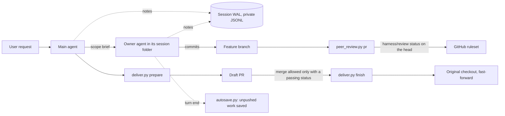

# Architecture

Agent Harness is a set of installed instructions, role definitions, generated sandbox settings and standalone Python helpers around Claude Code and Codex. There is no server and no daemon. State lives in files on the machine that runs the agents. The decided direction and its reasons are in [direction](direction.md); the exact behavior of each helper is in [operations](operations.md).

## Components

| Component | Where | What it does |
| --- | --- | --- |
| Standing rules | `HARNESS.md` (installed as a marked block in `~/.claude/CLAUDE.md`), `codex/AGENTS.md`, `codex/skills/agent-harness` | What is enforced and where, and the tools to use. Advice: an agent can ignore it; the boundaries below do not depend on it. |
| Roles | `harness/agents` (4 Claude roles), `codex/agents` (6 Codex roles) | Task owner, fixer, red-team, click-tester, plus reviewer and rescue on Codex. |
| Boundaries | `ah_sandbox.py`, `sandbox_base.json`, `ah_doctor.py` | Per-role sandbox and permission settings (worker, reviewer, supervisor) for Claude Code `--settings` or managed settings and for Codex permission profiles; `ah doctor` proves on the host that each denial holds, with a positive twin ([sandbox](sandbox.md), [doctor](doctor.md)). |
| Merge rule | `ah_repo.py`, `peer_review.py` | `ah repo protect` sets a GitHub ruleset that requires `harness/review`; the review runner posts it for the exact head ([merge-rule](merge-rule.md)). |
| Hooks | `ah_hook.py` and ten registrations | The off-switch launcher, the session folder (`session_env.py`), notes (`wal.py`), the save (`autosave.py`), the answer inbox (`owner_inbox.py`), the handoff nudge (`dropped_gate.py`) and the named database tool check (`prod_delete_guard.py`). None on Bash ([reference](harness-reference.md#hooks-release-1001)). |
| Tools | `ah.py` and the modules it dispatches to, `deliver.py`, `wal_note.py`, `bg_job.py` | `ah secret`, `ah log-push`, `ah kill`, `ah worktree-remove`, `ah reap`, `ah co`, `ah approvals`, `ah owners`, `ah status`, `ah off|on`. |
| Installers | `install.py`, `install_codex.py`, `log_backup_install.py`, `netwatch_install.py`, `mission_control_install.py` | Preview by default, `--apply` to write; they merge settings, back up replaced files and record the release ([off-switch](off-switch.md)). |
| Mission Control | `harness/mission_control`, `mission_control_install.py` | Optional local read-only dashboard; nothing in the core depends on it ([mission-control](mission-control.md)). |

## Data flow



1. A session gets its folder and TMPDIR at start (`session_env.py`). The sandbox, when the session was launched with a role's settings, limits writes to the project, the session folder and the caches, and denies reads of key files.
2. Agents add intent, decision, ask and handoff notes with `wal_note.py`. Transcripts are the mechanical record.
3. Review reports from `peer_review.py` name the reviewed HEAD; the runner posts `harness/review` for it. A later push is a new head with no status.
4. GitHub refuses a merge without that status, a force-push and a branch deletion. No hook judges a merge or commit command.
5. At every turn end unpushed work is saved; the reaper removes dead sessions' checkouts after saving them ([lifecycle](lifecycle.md)).

## Limits that shape the design

- Claude Code's sandbox covers its Bash tool; the file tools are held by permission deny rules, which a determined local user can edit.
- The review status can be forged with the owner's own token until the reviewer posts through an identity workers cannot read.
- Claude Code `--safe-mode` disables `CLAUDE.md` and hooks.
- Windows is untested for the Python helpers.
- Installed hooks run on the host's `python3` (3.9 on macOS); the installers need 3.10+ (Claude) or 3.11+ (Codex).

## Build and test

```sh
python3 -m compileall -q install.py harness tests
python3 -m unittest discover -s tests -v
```

`.github/workflows/ci.yml` runs the Python suite on Linux and macOS and imports every hook module on Python 3.9.
