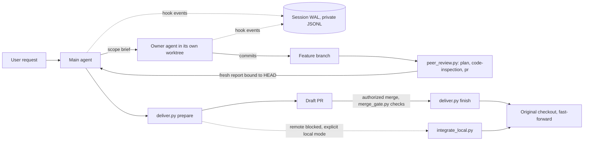

# Architecture

Agent Harness is a set of installed instructions, role definitions and standalone Python helpers around Claude Code and Codex, plus a small Go binary and an unreleased Go console. There is no server. State lives in files on the machine that runs the agents. This page describes what the repository contains; the exact behavior of each helper is in [operations](operations.md) and, for Claude, [HARNESS.md](../HARNESS.md).

## Components

| Component | Where | What it does |
| --- | --- | --- |
| Policy text | `HARNESS.md` (installed as a marked block in `~/.claude/CLAUDE.md`), `codex/AGENTS.md`, `codex/skills/agent-harness` | Tells the agent when to use the fast path, when to delegate, and which gates apply. Instructions only: an agent can ignore them. |
| Roles | `harness/agents` (4 Claude roles), `codex/agents` (6 Codex roles) | Task owner, fixer, red-team, click-tester, plus reviewer and rescue on Codex. |
| Hooks and helpers | `harness/hooks/*.py` | Python scripts called by tool hooks or by the main agent: `wal.py` (write-ahead log), `commit_policy.py`, `peer_review.py`, `deliver.py` and `integrate_local.py`, `merge_gate.py`, `command_guard.py`, `kill_guard.py`, `heavy_job_guard.py`, `spec_flow.py`, `provenance.py`, `usage_guard.py`, `escalation.py`, `ah.py`, `ops_watch.py`, `ahd.py`. |
| Installers | `install.py`, `install_codex.py`, `install_tui_plugin.py`, `log_backup_install.py`, `netwatch_install.py` | Preview by default, `--apply` to write; they merge settings and back up replaced files. |
| `harness` binary | `cmd/harness`, `internal/*` | Go CLI. Currently ports `harness tickets` (the local git-ref ledger, see [ledger](ledger.md)), `ledger-mcp`, and `version`. Other subcommands refuse and point back to the Python helper. |
| Console | `console/` | Local Go application with an embedded browser UI that drives Codex and Claude Code CLIs. Unreleased baseline; see [console](console.md). |
| TUI plugin | `plugins/harness-tui` | Optional offline reference view opened from a chat; also answers Mission Control chat from Claude desktop. See [tui-plugin](tui-plugin.md). |
| Mission Control | `harness/mission_control`, `mission_control_install.py`, `harness/hooks/mc_inbox.py` | Local read-only realtime fleet dashboard with chat, run by launchd on the Mac; see [mission-control](mission-control.md). |

## Data flow



1. Tool hooks append metadata (not prompt text or tool arguments) to a per-session WAL under `~/.claude/wals`, or `~/.agent-harness/codex-wals` on Codex. Agents add human-readable intent, decision and result notes with `wal_note.py`.
2. Commits pass `commit_policy.py` before they run (PreToolUse hook, plus a git `commit-msg` backstop on Git 2.54+).
3. Review reports from `peer_review.py` name a stage, the reviewed HEAD and the packet hash, so a stale report is detectable.
4. Merge and delete commands pass guard hooks (`merge_gate.py`, `command_guard.py`, `kill_guard.py`, `heavy_job_guard.py`) that fail closed on commands they cannot parse.
5. `deliver.py` publishes only the feature branch and never merges the PR. Recovery state is kept in the repository's Git common directory.

## Limits that shape the design

- The hooks are not a sandbox. They block known-dangerous command shapes and record evidence; they cannot prove a test was meaningful or a review independent. See [validation](validation.md) and [FINDINGS](FINDINGS.md).
- Claude Code `--safe-mode` disables `CLAUDE.md` and hooks.
- Windows is untested for the Python helpers.
- Python helpers need Python 3.10+ (Claude edition) or 3.11+ (Codex edition). CI also imports the hook modules on Python 3.9.

## Build and test

```sh
python3 -m compileall -q install.py harness tests
python3 -m unittest discover -s tests -v      # Python helpers (CI step "Unit and integration tests")
go vet ./... && go test ./...                 # repository root: harness binary and internal packages
cd console && go test ./... && go build -o harness-console .   # console, Go 1.22+
```

`.github/workflows/ci.yml` runs the Python and Go suites, checks that the committed CPython and secret-pattern goldens are current, and does a reproducible build. `console.yml` runs the console suite, race detector, vet and cross-platform builds. `release.yml` builds `harness` from a `v*` tag with attestation; no tag has been pushed yet.
